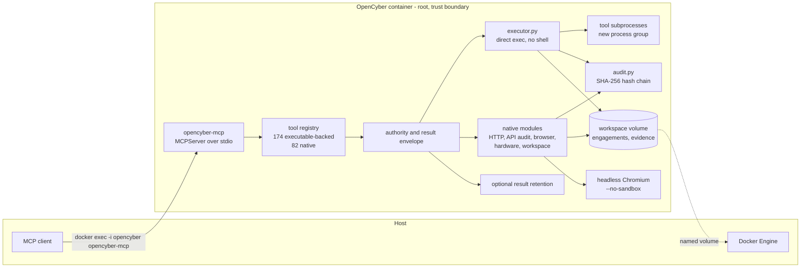

# Architecture

How the 0.5.0 private pre-production beta is put together: components, tool registration and counting, process model, storage layout, and the trust boundary. Start with [beta testing](BETA_TESTING.md) to use the harness; this page explains its internals.

> This document describes the runtime that provides offensive-security capability. Use it only against systems you own or are explicitly authorized to assess.

## Component and data flow



The client sends JSON-RPC over the stdin/stdout of a `docker exec` process. The server either dispatches an executable-backed tool through the direct runner or runs a native tool in the server process. Both paths return results; calls that touch the engagement write artifacts and audit events under it on the workspace volume.

## Components

| Module | Responsibility |
| --- | --- |
| `server.py` | Builds the MCPServer instance, registers all tools, binds the declared contract and result envelope to every registration, and implements `--self-test` and `--catalog-json`. |
| `contracts.py` | Declares the authority of every tool: kind, group, task shape, effects, scope, engagement requirement, destructive/open-world/idempotent flags, target-content flag, and reachable error codes. Owns the native inventory and derives MCP annotations and `_meta`. |
| `envelope.py` | Applies the uniform result envelope: `ok`, `contract`, `coverage`, `limitations`, `provenance`, `evidence`, `continuation`; converts failures into structured refusals and re-raises cancellation. |
| `errors.py` | Closed refusal registry (codes, categories, retryability, remediation), `OcError`, and the exception translator used by the envelope. |
| `limits.py` | Named resource ceilings with units, bounds, source, setting or parameter, recovery, and what they do not raise. |
| `catalog_identity.py` | Deterministic catalog projection, per-tool and set-level SHA-256, and alignment between the advertised and recorded contract. |
| `result_store.py` | Optional result retention (`off`/`digest`/`full`), the evidence index, `oc_result_get`, and `oc_result_list`. |
| `catalog.py` | Declarative `TOOL_GROUPS` inventory. Builds the 174-entry executable-backed catalog and category counts. |
| `diagnostics.py` | Derived native-tool inventory, self-test, the check-based doctor report, and human-readable report formatting. |
| `executor.py` | Validates argv, applies scope and offline decisions, executes without a shell under a named deadline and per-stream output cap, captures output, audits the call, and terminates process groups on cancellation. |
| `execution_tools.py` | Implements `oc_bash` and `oc_python` on top of the executor. |
| `native_tools.py` | HTTP and GraphQL requests, JWT decode, OpenAPI inspection, CVE lookup, HIBP, hashing, angr analysis, process snapshot, encoders, indicator extraction, and technology hints. |
| `poc_schema.py` | PoC-chain contract: capability vocabulary, record ids, canonical JSON/SHA-256, HMAC signing helpers, limits, redaction, engagement-relative paths, server-managed path guard. |
| `authorization.py` | Reads and verifies the operator-signed engagement authorization; scope/technique/custom-code predicates. Never writes signed records. |
| `cve_chain.py` | Deterministic capability-graph planning (`requires`/`provides` closure, missing tokens, cycles), nuclei/trivy artifact parsing, chain persistence. |
| `poc.py` | Declarative PoC specs, bounded stdlib verifier rendering, scope/forbidden-pattern lint, gated execution, assertion evaluation, evidence capture. |
| `poc_approval.py` | Operator CLI (`opencyber-poc`): authorization and single-use approval creation/revocation, HMAC verification, atomic consumption, status. |
| `api_audit.py` | Evidence-backed OpenAPI, GraphQL, and JWT audits plus bounded API parameter fuzzing. |
| `http_workbench.py` | Persistent HTTP sessions, scoped repeater, intruder, match/replace rules, cookies, and complete history. |
| `browser.py` | Playwright-managed headless Chromium contexts: navigation, snapshots, actions, screenshots, JavaScript evaluation, storage, and network interception. |
| `hardware.py` | Device inventory, per-domain readiness, hardware plans, persistent serial sessions, and firmware triage. |
| `workspace.py` | Engagement-confined list, read, write, append, delete, and structured finding reports. |
| `engagements.py` | Server-generated engagement IDs, manifests, listing, and path resolution with containment checks. |
| `audit.py` | Append-only SHA-256 hash chain, redaction, reading, verification, and summary. |
| `policy.py` | Optional scope enforcement for executable calls (argv tokens) and native HTTP calls (parsed URL host), plus the offline executable refusal list. |
| `assets.py` | Offline asset specifications, status measurement, manifest write and verify, offline posture, and the offline executable list. |
| `http_client.py` | Shared finite HTTP timeout validation and pre-send checks for native HTTP/API redirect hosts. |
| `doctor.py` | `opencyber-doctor` CLI and process exit status. |
| `assets.py`, `hardware.py`, `cve_index.py` entry points | Host-side asset inspection, hardware inspection, and local NVD index construction. |

## Tool registration and counting

The count is fixed at import time:

```text
174 executable-backed tools (CATALOG)
+ 82 native tools (contract registry)
= 256 advertised MCP tools in full mode
```

1. `catalog.build_catalog()` walks `TOOL_GROUPS`, normalizes each slug to `oc_<name>`, rejects duplicate names, and freezes the 174-entry `CATALOG`. Each entry carries a name, executable, category, and description.
2. `_registered_catalog()` in `server.py` applies the mode and category filter once, at module import:
   - `OPENCYBER_MCP_MODE=compact` returns an empty selection.
   - Otherwise, `OPENCYBER_TOOL_CATEGORIES` selects executable categories. An unknown category raises a `ValueError`, so the server fails to start instead of silently advertising a smaller set.
   - With neither variable set, all 174 entries are selected.
3. Every selected catalog entry is registered as an MCP tool with one shared async wrapper and one shared input schema: `engagement_id`, `arguments`, `working_directory`, and `stdin`.
4. The 82 native tools are registered explicitly with `@mcp.tool`. `contracts.CONTRACTS` is the single source of truth for their names, groups, task shape, effects, and scope; `diagnostics.FIXED_TOOL_CATEGORIES` is derived from it, and a binding pass attaches the declared contract and the result envelope to every registered tool. Tests compare the registry against the live tool manager and fail when either side has an extra name.
5. `oc_catalog` reads the full `CATALOG` plus the live MCPServer tool manager. It reports both `external_tool_count` (174) and `registered_external_tool_count` (the selected subset), plus the catalog digest and the advertised payload size, so compact and filtered modes remain discoverable and provable.
6. `catalog_identity` projects every advertised tool into a deterministic, digested view that is recorded in `src/opencyber/data/catalog.json`. `make catalog-check` fails when the recorded contract is stale, and a running server compares what it advertises with the recorded digest. See [CONTRACTS.md](CONTRACTS.md).

Mode arithmetic:

| Mode | Executable-backed advertised | Native advertised | Total |
| --- | ---: | ---: | ---: |
| Full | 174 | 82 | 256 |
| Compact | 0 | 82 | 82 |
| Category filter | Selected categories | 82 | 82 plus selection |

The category filter never removes native tools, including the native hardware tools. In compact mode, `oc_execute` dispatches any catalog entry by exact name.

`opencyber-doctor` and `opencyber-mcp --self-test` check that every required catalog executable and dependency resolves; optional integrations are reported separately. The image build runs the doctor and an explicit binary check before publishing, so a missing executable fails the build rather than the first tool call.

## Process model

```text
Container:
  PID 1: tini
    └─ sleep infinity                   keeps the container alive

  docker exec session (one per MCP client):
    └─ opencyber-mcp
         ├─ asyncio event loop + MCPServer stdio transport
         ├─ native tool work, offloaded with asyncio.to_thread where blocking
         ├─ tool subprocess (direct exec, no shell, new session)
         ├─ Chromium browser process shared by that server's browser contexts
         └─ serial PTY session per live serial session
```

`docker exec` processes are not children of the container's PID 1 process; the runtime starts them in the container namespace. They depend on the container being alive, which is why the image command is `sleep infinity` rather than a one-shot entry point.

- **One server process per client connection.** Multiple clients create multiple independent `opencyber-mcp` processes that share the workspace volume. Browser and serial session registries are in-process, so a session created by one client is not visible to another.
- **Executable calls are direct execs.** The runner resolves the executable with `shutil.which`, builds `[resolved, *argv]`, and calls `create_subprocess_exec`. No shell parsing occurs. The environment is inherited from the server with optional per-call overrides, except that names beginning with `OPENCYBER_APPROVAL_KEY` are removed from children. This reduces accidental disclosure; container-root code remains trusted. The working directory must resolve inside the engagement.
- **Cancellation is process-group cancellation.** The child starts in a new session. On cancellation or timeout, the server sends SIGTERM to the process group and SIGKILL after 2 seconds. Cleanup includes descendants even if the original leader has exited.
- **Two tools intentionally execute arbitrary shell or Python code, plus one gated runner.** `oc_bash` runs `bash -c <script>`. `oc_python` runs `python3 -c <source>` or an engagement-relative script. Both go through the same executor and therefore the same optional scope, offline, and audit checks. `oc_poc_run` is the third execution path: it runs a rendered or approved-custom verifier through `executor.execute_tool` with a mandatory scope preflight, a signed authorization and approval, bounded limits, a scrubbed environment, and evidence capture. It is not a general-purpose escape hatch; it refuses unless every gate passes. Other catalog tools may themselves spawn helpers, but the harness never adds a shell around their argv.
- **Native tools run in the server process.** The MCP 2.x SDK runs synchronous handlers in worker threads; asynchronous handlers stay on the event loop and move blocking network and retained-result work to a thread. Native HTTP connect/read waits use the timeout policy. Cancelling an awaiting coroutine does not forcibly terminate a Python worker thread.
- **Browser sessions are Playwright contexts.** The server launches one Chromium browser process per server process and creates a context and page for each live session. Chromium runs with `--no-sandbox` and `--disable-dev-shm-usage`. Sessions are closed explicitly with `oc_browser_close`, or implicitly when the server process exits.
- **Serial sessions hold a PTY in the server process.** Reads and writes are persisted to a transcript, so output is not lost between agent turns.

## Storage layout

The workspace root is `/workspace` by default and can be overridden with `OPENCYBER_WORKSPACE`.

```text
/workspace/
  engagements/
    eng_YYYYMMDD_<32 hex>/
      engagement.json                  server-managed manifest
      artifacts/                       tool output and working files
      evidence/                        request/response captures, screenshots, reports
      findings/                        structured Markdown findings
      .opencyber/
        audit/
          events.jsonl                 SHA-256 hash-chained audit events
        results/
          index.jsonl                  retained result index (retention=digest/full)
          <evidence_id>.json           redacted retained payload (retention=full)
        http-sessions/
          http_YYYYMMDD_<32 hex>.json            session state
          http_YYYYMMDD_<32 hex>.history.jsonl   complete request/response history
        browser/
          browser_YYYYMMDD_<32 hex>/             screenshots and browser artifacts
      hardware/
        serial/
          ser_YYYYMMDD_<32 hex>.jsonl            serial transcript
      poc/                               server-managed CVE-chain PoC subtree
        authorization.json               operator-signed authorization record
        authorization-history/           superseded signed records
        chains/                          capability graphs and verdicts
        specs/                           declarative PoC specs
        code/                            rendered or custom verifier source
        approvals/                       operator-signed single-use approvals
        runs/                            per-run result, output, transcript, evidence
```

Creation is atomic: the server builds a temporary engagement directory, writes `engagement.json`, and renames the directory into place. Path resolution rejects symlinked engagement roots, unknown IDs, and any path that resolves outside the engagement. `engagement.json` is protected from workspace write and delete operations; there is no engagement close or delete tool in 0.5.0. Result retention is off by default in content terms: `.opencyber/results/` holds an index unless `OPENCYBER_RESULT_RETENTION=full`, and the per-result digest exists regardless. The whole `poc/` subtree is likewise server-managed: workspace writes and deletes refuse it, and authorization, approval, chain, spec, code, and run records are written by their owning modules with atomic replaces.

HTTP session state is replaced atomically with a temporary file and rename. History is appended line by line as JSONL. Audit events are appended under a file lock and include the previous event's hash. Retained-result updates, pruning and reads use a cross-process lock; corrupt indexes or symlinked retained records are refused. PoC approvals are revalidated and durably consumed under a lock before executor launch, so an interrupted attempt cannot reuse its approval.

## Asset manifest

The image records its offline asset inventory during the build:

```sh
opencyber-assets --write /usr/share/opencyber/asset-manifest.json --deep --json
opencyber-assets --verify --deep --json
```

The manifest is stored at `/usr/share/opencyber/asset-manifest.json` by default. `OPENCYBER_ASSET_MANIFEST` overrides the path. It contains a schema version, generation time, and per-asset count, byte size, SHA-256, and required flag. Assets include nuclei templates, the generated baseline password dictionary, Seclists, exploitdb, bundled Metasploit modules and Nmap scripts, hardware rules, and the optional CVE index.

At run time:

- `opencyber-assets` measures the assets and can compare them with the manifest.
- `opencyber-doctor` treats a missing required asset or a manifest mismatch as degraded and exits 1.
- `opencyber-mcp --self-test` checks executable presence and reports the analysis runtime.
- `oc_assets_status(deep=true, verify=true)` exposes the same data through MCP.
- `oc_offline_status()` reports offline mode, asset readiness, local CVE database presence, blocked executables, and internet-dependent features.

## Trust boundary

The container is the security boundary. That is the deliberate design trade: real offensive tooling needs filesystem, network, and raw-socket access that a per-tool sandbox would block.

Consequences you must design around:

- **Root inside, hardened from outside.** The container runs as root. Host hardening is capability dropping, `no-new-privileges`, a read-only root filesystem with tmpfs mounts, dropped devices, and network policy. The included tools do not require `--privileged`.
- **No per-tool sandbox.** Code executed through `oc_bash`, `oc_python`, or a compromised executable can reach the container filesystem and network. Engagements isolate artifacts, not hostile code.
- **Chromium is not sandboxed.** It runs with `--no-sandbox` inside the container.
- **Scope enforcement is narrow.** Executable-backed calls check extracted argv targets when `OPENCYBER_ENFORCE_SCOPE=1`. Native HTTP, GraphQL, OpenAPI, GraphQL audit, and API fuzz check the engagement target before every request and redirect hop. The HTTP workbench also enforces its session scope. Browser traffic remains outside engagement scope enforcement; a hard network boundary requires host-level policy.
- **Offline mode is not an egress firewall.** It refuses a small list of internet-only executables and network-dependent native features. It does not block arbitrary traffic.
- **Audit is tamper-evident, not tamper-proof.** Root can rewrite the chain. The control detects internal removal, reordering, and edits. Detecting removal from the end requires a previously retained final hash. Some native call sites record best-effort, and executor audit can be disabled with `OPENCYBER_AUDIT=0`.
- **Evidence can contain secrets.** Audit redaction covers credential-like fields at the audit boundary, but artifacts, HTTP history, browser state, and screenshots are not redacted.

For the full threat model, deployment guidance, and residual risks, see [SECURITY_MODEL.md](SECURITY_MODEL.md). For the tool inventory, see [TOOLS.md](TOOLS.md).
